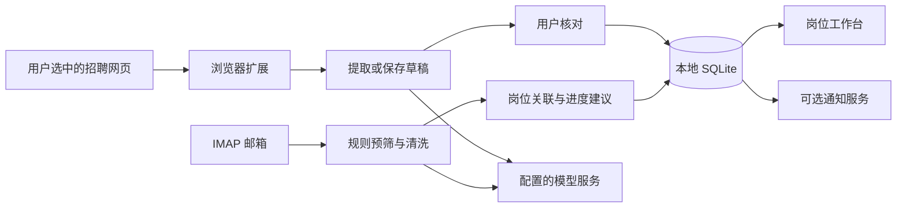

# 架构说明

应用是本地单进程的 FastAPI 模块化单体，使用 SQLAlchemy 2、SQLite、Alembic、Jinja2、原生 ES modules 和 Chrome MV3 扩展。

范围为 JOB 平台及 Chrome 扩展。可从 [总体开发指南](docs/development.md) 定位修改入口，或打开 [Understand-Anything 项目地图](https://yhonc.github.io/local-job-assistant/map/) 浏览分层与中文导览。地图是静态源码快照，导入边、调用边和测试关联分别解释；不代表真实运行追踪。

## 模块职责

| 目录 | 职责 |
| --- | --- |
| `app/main.py` | 页面路由、API 装配、生命周期与调度器 |
| `app/core/`、`app/credentials/` | 环境配置与操作系统凭据存储 |
| `app/database/` | ORM 模型、数据库会话与状态历史 |
| `app/api/` | 公司、岗位、申请及偏好等基础接口 |
| `app/workbench/` | 聚合查询、统一保存、版本检查、批量与状态操作 |
| `app/imports/` | 网页提取、草稿、查重、确认与提示词设置 |
| `app/email_sync/` | IMAP、预筛、清洗、归档、匹配与进度建议 |
| `app/llm/` | 模型路由、结构校验、代理、用量与健康检查 |
| `app/notifications/` | 提醒策略、发送记录、幂等与重试 |
| `app/static/js/workbench/` | 五个工作台视图、编辑组件和设置适配 |
| `extension/` | 用户触发的当前页采集和解析队列 |

## 数据流

公司、岗位与申请为核心实体；邮件清洗结果、事实条目、状态建议与通知分别建模。岗位整理状态、类别核对状态和投递状态相互独立。邮件关联本身不会改变投递进度；进度建议需用户明确接受。

数据库默认启用外键与 WAL。工作台跨实体操作使用事务、版本号及幂等键；旧 CRUD 页面保留兼容行为，版本保护能力与新工作台并不完全相同。

## 运行边界

- 本机单用户设计；Origin 检查不是身份认证，不应直接暴露公网。
- IMAP、通知和模型健康检查由进程内调度器执行；SQLite 租约不构成通用分布式任务系统。
- 通用模型接口通过 LiteLLM/HTTPX 适配，代理按请求选择；真实网络服务需单独验收。
- 当前迁移链至 `0018_llm_local_proxy`。迁移文件存在不代表用户的本地数据库已经升级。
- 页面路由 `/workbench` 为主入口，`/legacy/tracker` 与旧详情、设置等保留兼容。

## 测试隔离

`create_app` 可注入数据库、凭据存储、模型 completion、IMAP provider、通知 adapter 和调度开关。自动测试使用临时库与 fake/mock 服务；工作台预览使用 `scripts/dev/serve_workbench_preview.py` 创建合成资料。

浏览器验证与后端测试各自证明其覆盖范围，不能据此推断真实邮箱、模型或 Push 服务可用。见 [开发说明](docs/development.md)。
