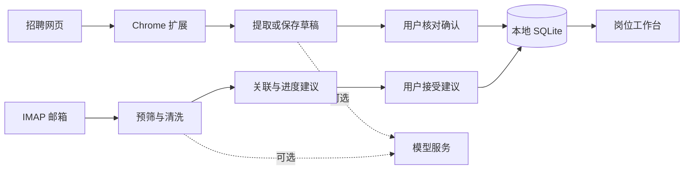

# JOB 平台 · Local Job Assistant

**把招聘网页、岗位收藏、投递进度和招聘邮件，整理到一个本机运行的求职工作台。**

[开始使用](#快速开始) · [开发指南](docs/development.md) · [Chrome 扩展](extension/README.md) · [MIT License](LICENSE)

## 项目能做什么

| 场景 | 功能 |
| --- | --- |
| 在招聘网站发现岗位 | Chrome 扩展捕获当前页面；直接保存待整理，或加入 AI 解析队列，核对后入库 |
| 建立自己的岗位库 | 管理公司、岗位、来源、标签和分类，组合筛选、搜索、分页、批量整理与归档 |
| 跟进每一次投递 | 更新投递状态、查看变更历史和撤销操作；岗位整理状态与投递进度分别保存 |
| 处理招聘邮件 | 可选 IMAP 增量同步、预筛、结构化清洗、岗位关联与进度建议；接受建议后才更新申请状态 |
| 配置模型与提醒 | 多模型配置与任务路由、提示词模板、代理、健康检查、用量记录，以及可选桌面或 Push 提醒 |

主界面包含 **岗位库、待整理、投递跟进、邮件与提醒、设置** 五个视图。基础岗位管理不需要模型或邮箱，需要解析或同步时再连接外部服务。

本仓库的产品范围是 **JOB 平台与配套 Chrome 扩展**。个人采集 skill、批次处理脚本、招聘数据集和个人求职资料不包含在开源发布中。

## 快速开始

需要 **Python 3.11+** 和 Git。推荐 Windows 一键启动；应用默认监听本机 `127.0.0.1:8765`。

```powershell
git clone https://github.com/YHonc/local-job-assistant.git
cd local-job-assistant
```

双击根目录的 **`一键启动.bat`**。首次运行会创建 `.venv`、安装运行依赖、执行数据库迁移并打开浏览器。

打开 **<http://127.0.0.1:8765/workbench?view=library>**，点击“新增岗位”即可开始。保持启动窗口开启，使用 `Ctrl+C` 停止服务。

<details>
<summary>手动安装与启动</summary>

在项目根目录运行：

```powershell
py -m venv .venv
.\.venv\Scripts\python.exe -m pip install -e .
.\.venv\Scripts\python.exe -m alembic upgrade head
.\.venv\Scripts\python.exe -m uvicorn app.main:app --host 127.0.0.1 --port 8765
```

默认数据库是项目目录内的 `local_job_assistant.db`。可通过 `DATABASE_URL` 指定其他位置；迁移和应用启动必须使用同一配置。更新数据库前先备份。

</details>

## 用 Chrome 扩展收集岗位

1. 启动本地工作台。
2. 打开 `chrome://extensions`，开启开发者模式。
3. 选择“加载已解压的扩展程序”，加载本仓库的 `extension/`。
4. 打开招聘网页，点击扩展。
5. 选择“保存到待整理”，或配置模型后选择“把当前页加入解析队列”。
6. 检查提取字段与重复候选，确认后加入岗位库。

扩展支持后台解析队列、任务恢复、逐项核对与批量添加。更新扩展文件后需要在扩展管理页重新加载。权限、存储与重试说明见 [扩展 README](extension/README.md)。

## 可选集成

**AI 模型：** 在设置中添加模型配置。项目通过 LiteLLM/HTTPX 适配多种接口，支持自定义提示词、模型路由和代理；具体服务的认证、结构化返回和网络行为需单独验证。

**招聘邮箱：** 配置 IMAP 地址与邮箱授权码，支持 QQ、163 预设和自定义邮箱，可设置同步窗口和预筛规则。邮件清洗、关联与进度建议各有状态，不以一次同步请求成功代表全部处理完成。

**通知：** 按需启用桌面或 Push 提醒。请先使用测试目标核对发送记录、重试与实际收件。

## 架构与开发

后端采用 **FastAPI + SQLAlchemy + SQLite**，以 **Alembic** 管理迁移；前端采用 **Jinja2 + 原生 JavaScript ES modules**，Chrome 扩展使用 **Manifest V3**。



| 目录 | 职责 |
| --- | --- |
| `app/` | 后端模块、ORM、模板、前端脚本与样式 |
| `extension/` | Chrome 采集扩展与解析队列 |
| `migrations/` | 数据库迁移 |
| `tests/` | Python 和 Node.js 测试 |
| `scripts/` | 启动、预览与发布检查工具 |
| `docs/` | 开发、架构、验收与隐私文档 |

开发依赖安装：`python -m pip install -e ".[dev]"`。前端不需要应用构建；前端测试需要 Node.js。

开发顺序与命令见 [总体开发指南](docs/development.md)，简版设计见 [架构说明](ARCHITECTURE.md)。修改数据模型、共享 schema、状态或扩展协议时，请同步维护对应测试。

## 数据与运行边界

- 本机单用户设计；Origin 检查不是用户身份认证，请勿直接暴露到公网。
- 岗位、申请、邮件和设置保存在本地数据库，密钥与授权信息使用系统凭据存储。
- 使用模型、IMAP 或 Push 时会访问所配置的外部服务；“本地运行”不等于所有处理都离线。
- 自动测试和合成预览各有覆盖范围，不能替代真实模型、邮箱、浏览器扩展和通知的完整验收。
- 数据库、邮件、密钥、导出、缓存及私有开发资料不进入公开仓库。

详见 [数据与隐私说明](docs/privacy.md) 和 [人工验收清单](docs/manual-qa.md)。

## 参与与许可证

欢迎通过 Issue 描述可复现问题，或提交范围明确的改进。提交前运行受影响测试并检查暂存内容；不要提交真实岗位资料、邮箱内容或凭据。

JOB 平台采用 [MIT License](LICENSE)，保留原始版权与许可声明。项目使用的第三方依赖仍适用各自许可证。
