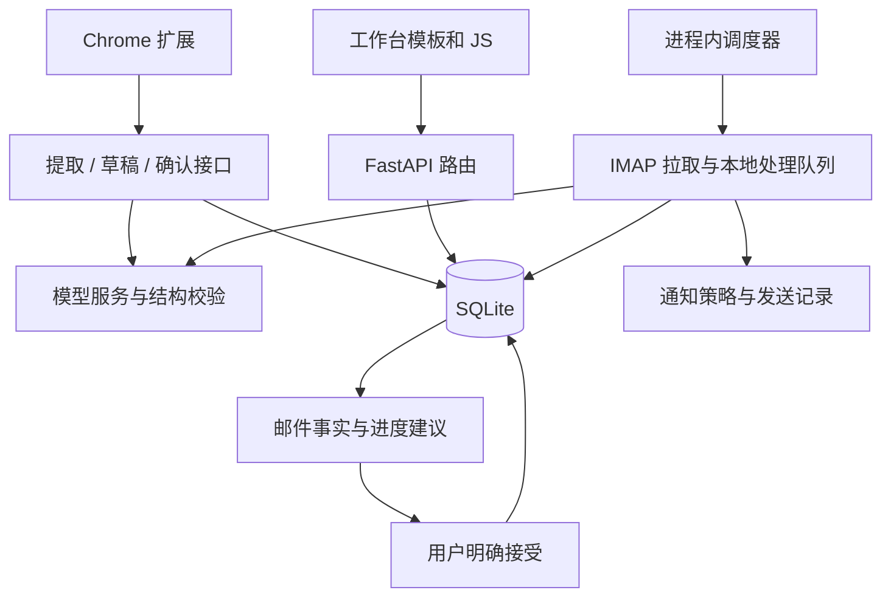

# 项目总体开发指南

维护基线：2026-10-22。本文件是 JOB 平台（含 Chrome 浏览器扩展）的统一开发入口，依据当前源码整理。本地个人采集 skill、批次数据处理和求职资料不属于本开源项目范围。它说明模块边界、数据契约、修改入口和验证方法；不代表真实模型、邮箱、通知或用户数据库已经完成验收。

## 1. 项目目标与阅读顺序

Local Job Assistant 是本机单用户的求职信息管理工作台：收集网页岗位、维护岗位库、记录投递、处理招聘邮件并生成可确认的进度建议。核心闭环是“采集 → 核对 → 保存 → 跟进”，并非自动代投系统。

建议按以下顺序阅读：

1. [README](../README.md)：产品功能和普通用户启动方式。
2. 本指南：开发边界、数据与调用链、按任务定位源码。
3. [架构说明](../ARCHITECTURE.md)：简版模块图；[人工验收](manual-qa.md)：交互及外部集成检查；[隐私说明](privacy.md)：数据与发布约束。
4. 对应模块的 schema、实现和测试：接口字段以 schema 为准，行为以源码和可复现测试为准。

遇到资料冲突时，区分三类依据：当前源码说明实现；计划和历史记录说明当时意图；本次运行日志说明这次实际发生的行为。旧测试报告不能直接证明当前代码通过。

## 2. 工作区内容与职责

| 范围 | 内容与用途 | 后续开发原则 |
| --- | --- | --- |
| `app/` | FastAPI 后端、ORM、模板、原生 JavaScript 和 CSS | 主应用的实现依据 |
| `extension/` | Chrome Manifest V3 扩展、采集和后台解析队列 | 与后端导入协议共同维护 |
| `migrations/` | Alembic 数据库演进 | 正式数据库通过迁移升级 |
| `tests/` | Python 测试、Node 内置测试运行器的 `.test.cjs` | 按受影响契约选择检查 |
| `scripts/start_local.ps1`、`一键启动.bat` | Windows 启动链 | 会安装依赖、迁移数据库、启动服务 |
| `scripts/dev/` | 合成数据预览和历史浏览器检查脚本 | 核对当前选择器和依赖后再用 |
| `local/`、`backups/`、`output/`、`.tmp/` | 私有资料、数据库备份、验收产物与临时库 | 保持隔离，不混入公开源码 |
| 根目录数据库与 WAL/SHM | 用户运行数据 | 不用于测试，不直接复制运行中的单个 DB 文件充当一致性备份 |

开始下一项改动前先看 `git status --short`，避免覆盖已有工作。开发环境、安装的第三方 skill 与个人资料保留在本地；公开文件应逐项审阅后提交。

## 3. 技术结构和运行装配

依赖声明见 [pyproject.toml](../pyproject.toml)：Python 3.11+、FastAPI、SQLAlchemy 2、SQLite、Alembic、Jinja2、LiteLLM、HTTPX、keyring、imap-tools、APScheduler 与 Apprise。前端为浏览器原生 ES modules，没有应用打包构建步骤；Node.js 用于前端测试。依赖使用版本范围，声明版本不等于本机实际安装版本。



此图表示源码职责与主要数据流，不是实际运行 Trace，也不表示任意数据库写入都会自动触发通知。

装配入口是 [app/main.py](../app/main.py) 的 `create_app`：创建 engine/session factory、凭据存储、通知服务、邮件服务、同步协调器、模型健康协调器和可选调度器，再注册路由、模板与静态文件。依赖可注入，便于隔离测试。

- `/` 默认重定向 `/workbench`；带旧 `edit` 参数的书签转到 `/legacy/tracker`。
- 工作台五个视图为 `library / pending / follow / mail / settings`，由 [router.js](../app/static/js/workbench/router.js) 解析与过滤 URL 参数。
- [bootstrap.js](../app/static/js/workbench/bootstrap.js) 管理视图挂载、清理、请求取消和导航守卫。新增视图需维护路由、挂载与清理行为，而非仅新增模板。
- 旧 `/legacy/tracker`、`/jobs/{job_id}`、`/settings`、`/events`、`/notifications` 仍保留。修改共享接口时要考虑这些调用者。
- [app/api/routes.py](../app/api/routes.py) 使用 `/api` 前缀挂载基础 CRUD、工作台、草稿、提示词和邮件进度路由；模型、旧导入及邮件等模块也有自己的路由装配，不可凭文件名猜最终 URL。

## 4. 核心数据与不可混淆的状态

主要实体见 [database/models.py](../app/database/models.py)，补充实体见 [draft_models.py](../app/imports/draft_models.py) 和 [progress_models.py](../app/email_sync/progress_models.py)。

| 实体 | 作用与关系 | 维护时关注 |
| --- | --- | --- |
| `Company` | 公司名称唯一，一家公司对应多个岗位 | 删除受岗位外键限制；不要按展示名称随意合并 |
| `Job` | 岗位、来源、分类、标签、整理状态、版本 | `company_id` 必填；`published_at` 与 `created_at` 意义不同 |
| `Application` | 一个岗位至多一个申请记录，允许岗位没有申请 | `job_id` 唯一；不要在普通编辑中无意创建申请 |
| `WorkbenchIdempotencyRecord` | 工作台创建请求的幂等账本 | 相同键不同载荷必须冲突 |
| `ImportDraft` | 原文、用户字段、模型建议和确认结果 | `draft / extracted / confirmed`；模型建议与用户字段分开 |
| `EmailAccount / EmailMessage` | 邮箱配置、UID 游标、同步状态与邮件 | UIDVALIDITY、UID、Message-ID 去重和正文留存规则 |
| `EmailCleaningResult / EmailJobEntry` | 清洗结果与邮件中的岗位事实条目 | 一封邮件可包含多个岗位事实，不能简单等同一封邮件一个岗位 |
| `EmailArchive / RecruitmentEvent` | 清洗归档与招聘事件 | 与邮件、岗位关联和通知各有生命周期 |
| `EmailProgressSuggestion` | 对申请状态变更的待确认建议 | 保存事实快照和版本；接受前重新检查 |
| `ApplicationStatusHistory` | 状态变更历史、来源和关联建议 | 直接 SQL 写入不会经过 ORM 的历史记录事件 |
| `LLMConfiguration / LLMRoutingSettings` | 模型配置与任务路由 | 配置存在不代表模型可用 |
| `LLMProxySettings / LLMHealthState / LLMUsageEvent` | 代理、健康状态与用量记录 | 健康、实际调用和计费证据分别解释 |
| `NotificationPolicy / Notification` | 提醒策略、发送状态与重试记录 | 防重和重试不能被界面重复操作绕过 |
| `Setting` | 应用偏好及其他配置值 | 按所属 schema 和设置接口修改 |

三组状态相互独立：

- `Job.organize_status`：岗位整理进度。
- `Job.category_review_status`：职位类别是否核对。
- `Application.status`：投递进度。

当前快捷状态和旧值兼容规则统一看 [application_statuses.py](../app/application_statuses.py)，不要只修改页面文字或 ORM 枚举。分类规则看 [job_categories.py](../app/job_categories.py)；方向推断看 [job_directions.py](../app/job_directions.py)，存在推断代码不代表页面仍展示方向筛选。

### 写入一致性

[workbench/routes.py](../app/workbench/routes.py) 的 `workbench_job_create` 在同一事务内处理公司、岗位、可选申请和幂等账本。创建需要 `idempotency_key`；重试同一请求应沿用该键，同键不同内容返回冲突。

`workbench_job_update` 检查 `expected_job_version`，更新申请时还检查 `expected_application_version`。`Job` 与 `Application` 同时使用 SQLAlchemy 的 `version_id_col` 防止过期 ORM 更新。收到 409 应重新加载并让用户处理冲突，不应自动覆盖。旧 CRUD 的客户端版本前置检查与工作台并不完全相同，不可把两套接口当成无差别替代品。

[workbench/status.py](../app/workbench/status.py) 集中实现快捷状态操作、批量状态、历史与撤销。状态历史还依赖 ORM session 事件；新增写入路径必须核对版本和历史是否完整。

## 5. 主要业务链路与接口契约

### 5.1 岗位库与投递跟进

阅读顺序：`templates/workbench.html` → `static/js/workbench/bootstrap.js` → `views/library.js` 或 `views/follow.js` → `app/workbench/routes.py` / `status.py` → `app/api/schemas.py` → ORM。

关键接口包括 `GET/POST /api/workbench/jobs`、`GET/PATCH /api/workbench/jobs/{job_id}`、`POST /api/workbench/jobs/bulk-organize`。查询、分页与筛选返回结构看 `WorkbenchJobListOut`；创建与更新结构看 `WorkbenchJobCreate / WorkbenchJobUpdate`。新增字段应同时检查输入校验、ORM、迁移、列表和详情输出、编辑器、筛选和测试，而不是仅加数据库列。

### 5.2 网页提取与持久化草稿

现有两条入口需要分别维护：

| 入口 | 调用链 | 契约 |
| --- | --- | --- |
| 直接解析后确认 | 扩展 → `POST /api/imports/job/extract` → `LLMService.extract_job` → 重复候选 → `POST /api/imports/job/confirm` | `PageCapture → ExtractResponse → ConfirmRequest` |
| 先保存待整理 | 扩展/工作台 → `/api/import-drafts` → 可选提取 → 接受建议字段 → 确认 | `CreateImportDraftRequest`、版本请求、`ConfirmImportDraftRequest` |

源码入口：[imports/router.py](../app/imports/router.py)、[imports/schemas.py](../app/imports/schemas.py)、[imports/drafts.py](../app/imports/drafts.py)、[draft_schemas.py](../app/imports/draft_schemas.py)、[duplicate.py](../app/imports/duplicate.py)。

- 捕获的 URL、正文与选中文本有长度及协议校验；不要绕过 schema 直接保存任意载荷。
- 草稿的 `user_fields` 与 `suggested_fields` 分离，模型提取成功不等于用户已经接受字段或确认入库。
- 草稿创建使用幂等键；修改、接受建议和确认检查版本。确认可不创建申请记录。
- 查重依据包括规范化来源 URL、公司和岗位标题；重复候选允许用户明确决定，不能把低置信候选直接合并。
- `ExtractResponse.telemetry` 可缺省，token 可为 `null`；未知不能显示成 0。扩展重试需清理旧 telemetry，并保留旧响应兼容性。
- 提示词维护入口为 [prompt_settings.py](../app/imports/prompt_settings.py)，前端为 `components/prompt-settings.js`；自定义提示词不应绕过结构校验。

扩展内部任务恢复、会话正文和持久化摘要的区别见 [扩展说明](../extension/README.md)。修改后要重载扩展；网页刷新不等于扩展已更新。

### 5.3 邮件同步、清洗与进度建议

[email_sync/service.py](../app/email_sync/service.py) 的 `EmailSyncCoordinator.sync → EmailSyncService.sync_account` 是主链路：先 IMAP 拉取、去重、持久化与推进游标，再处理本地候选队列，避免模型延迟阻塞拉取进度。

配置正则时，正则是主要筛选闸门；未通过的邮件仅保留摘要用于去重，不落正文且不进入识别队列。没有正则时使用关键词筛选。改变预筛规则前需同时检查 `filtering.py`、`sync_account` 和隐私说明。

后续处理涉及 `cleaning.py`、`archiving.py`、`matching.py` 以及 `EmailJobEntry`。清洗结果、岗位关联、招聘事件、进度建议是不同对象。`sync_account` 的 `success / partial / error` 反映同步处理情况，不能简化为“接口返回 200 就全部处理成功”。

[progress.py](../app/email_sync/progress.py) 的 `accept_progress_suggestion` 对应 `POST /api/progress-suggestions/{suggestion_id}/accept`。接受时核对建议、事实条目、清洗版本、申请版本和快照，并重新判断证据是否支持目标状态；之后才更新申请和历史。关联邮件或生成建议本身不会推进投递状态。

### 5.4 模型、代理、用量与凭据

入口为 [llm/routes.py](../app/llm/routes.py)，核心调用为 [LLMService.structured_extract](../app/llm/service.py)。模型任务先读取配置和凭据、解析代理，再发起请求并按 Pydantic schema 验证返回。`json_schema` 请求被拒绝时存在一次 `prompt_json` 降级路径；结构化请求成功仍需输出校验。

- 模型选择、扩展失败切换和服务内部结构化降级是不同层次，排错时分别查看请求入口、实际配置和异常分类。
- 请求级 telemetry 与累计用量记录分别维护：前者允许缺失 usage 保持未知；草稿提取的部分累计记账调用仍把缺失 token 按 0 传入。修改统计时先统一口径，不能把累计 0 当成已证实未消耗 token。不要凭日志中一次成功宣称所有 Provider 兼容。
- 代理规则在 [proxy.py](../app/llm/proxy.py)，健康检查在 [health.py](../app/llm/health.py)，统计在 [usage.py](../app/llm/usage.py)。
- 密钥、邮箱授权码和 Push 目标使用 [credentials](../app/credentials/__init__.py) 的凭据存储。测试注入 fake store，不读取个人凭据。

### 5.5 调度与通知

[LocalScheduler](../app/email_sync/scheduler.py) 每分钟检查到期邮箱并重试通知；模型健康调度周期为 15 秒，具体是否执行由协调器决定。任务配置 `coalesce=True` 和 `max_instances=1`。调度器随 FastAPI lifespan 启停，当前是单进程设计。

[NotificationService](../app/notifications/service.py) 按策略创建发送记录、处理防重、发送和到期重试。修改时分别验证“记录创建”“adapter 成功”“目标实际收到”；mock adapter 成功只能证明测试覆盖的逻辑。不要直接通过多 worker 或放大并发解决慢任务，否则需先重新设计调度与锁的边界。

## 6. 按开发任务定位修改范围

| 任务 | 优先入口 | 同时检查与验证 |
| --- | --- | --- |
| 新增岗位字段/筛选 | `api/schemas.py`、`database/models.py`、`workbench/routes.py` | Alembic、编辑器、列表、工作台与旧 CRUD 测试 |
| 改投递状态/撤销 | `application_statuses.py`、`workbench/status.py` | 历史记录、旧状态、邮件建议、前端状态组件 |
| 调整网页提取/查重 | `imports/router.py`、`schemas.py`、`duplicate.py` | 扩展确认协议、草稿路径、提示词、telemetry |
| 修改待整理流程 | `imports/drafts.py`、`draft_schemas.py`、`views/pending.js` | 幂等、版本冲突、接受字段、重复确认 |
| 修改邮箱处理 | `email_sync/service.py`、`filtering.py`、`cleaning.py` | UID 去重、正文保存、失败重试、归档、多个岗位条目 |
| 修改进度建议 | `email_sync/progress.py`、`progress_models.py` | 快照过期、并发接受、幂等、历史和用户明确确认 |
| 增加模型或代理能力 | `llm/service.py`、`routes.py`、`proxy.py` | 凭据错误、返回结构、用量缺失、实际网络单独验收 |
| 调整设置交互 | `views/settings.js`、`components/`、`integrations/` | 分区保存、未保存草稿、URL 深链接、旧设置页 |
| 调整界面/样式 | `templates/workbench.html`、`static/css/workbench/` | 主题、响应式、键盘、挂载清理和缓存版本参数 |
| 增加外部提醒 | `notifications/service.py`、`schemas.py` | 策略、防重、失败记录、重试、测试目标收件 |

## 7. 环境、数据库与开发启动

在项目根目录使用 PowerShell；开发依赖需要安装 `.[dev]`，普通运行安装并不保证 pytest 已存在：

```powershell
py -3.11 -m venv .venv
.\.venv\Scripts\python.exe -m pip install -e ".[dev]"
```

已有 `.venv` 时复用，先确认解释器和依赖，避免无必要重建。配置入口 [core/config.py](../app/core/config.py) 读取 `DATABASE_URL`，默认 `sqlite:///./local_job_assistant.db`，相对路径随工作目录解析；应用和 Alembic 必须使用同一目标配置。

正式启动方式见 README。`scripts/start_local.ps1 -CheckOnly` **也会执行 `alembic upgrade head`**，不是只读环境探测；不要为了阅读代码而运行它。

开发数据库迁移应先使用临时库，命令示例如下（新的 PowerShell 窗口执行，结束后关闭该窗口，避免环境变量影响正式启动）：

```powershell
New-Item -ItemType Directory -Force .tmp | Out-Null
$env:DATABASE_URL = "sqlite:///./.tmp/dev-guide.db"
.\.venv\Scripts\python.exe -m alembic upgrade head
.\.venv\Scripts\python.exe -m alembic current
```

当前源码迁移链至 `0018_llm_local_proxy`；具体以 `migrations/versions/` 为准。`create_app(create_tables=True)` 方便测试直接建表，但不能验证迁移链。新增表还需确认已注册到 `Base.metadata` 和 [migrations/env.py](../migrations/env.py)。迁移验收至少覆盖空库升级与已有数据升级，保留旧数据和约束；在真实数据库执行前先做一致性备份并明确授权范围。

默认正式应用启用调度；调用真实启动入口可能触发已启用的邮箱、模型健康检查或通知重试。纯界面开发优先使用下方注入外部 I/O 替身的预览。

## 8. 本地检查

```powershell
.\.venv\Scripts\python.exe -m pytest -q --basetemp .tmp/pytest-local
node --test (Get-ChildItem -LiteralPath tests -Filter '*.test.cjs').FullName
.\.venv\Scripts\python.exe -m compileall -q app migrations
.\.venv\Scripts\python.exe -m pip check
```

若临时目录已存在或权限异常，请换一个新的 `.tmp/pytest-*` 路径。测试使用临时 SQLite、fake 凭据、mock IMAP/模型/通知；不要把测试数据库地址改成个人数据库。

pytest 的 `--basetemp` 是可被清理的测试目录，必须使用专用临时路径，不得指向备份、产物或用户资料目录。

| 改动范围 | 优先测试文件 |
| --- | --- |
| 基础 CRUD、分类 | `test_v0_api.py`、`test_job_categories.py` |
| 工作台、状态、迁移 | `test_workbench_core.py`、`test_status_model_health.py`、`test_workbench_migrations.py`、`test_migrations.py` |
| 网页提取、草稿、提示词 | `test_v1_imports.py`、`test_import_drafts.py`、`test_prompt_settings.py`、`test_extension_v1.py` |
| 模型、代理 | `test_v1_llm.py`、`test_llm_proxy.py`、`test_status_model_health.py` |
| 邮件、归档、进度 | `test_v2_email.py`、`test_email_archive_acceptance.py`、`test_mail_progress.py` |
| 通知 | `test_v3_notifications.py` |
| 前端生命周期、设置、扩展 | `frontend-runtime.test.cjs`、`settings-lifecycle.test.cjs`、`extension-drafts.test.cjs`、`extension-telemetry.test.cjs`、`workbench-ui.test.cjs`、`workbench-integrations.test.cjs` |
| 发布规则 | `test_publication.py` 与 `scripts/check_publication.py` |

按改动选择测试；数据模型、共享 schema 或公共设置协议变更再扩展回归。新增测试优先覆盖真实行为边界：同键不同载荷、旧版本、重复提交、缺失用量、部分失败、历史记录、页面切换后旧请求返回，而非重复实现代码。

## 9. 浏览器预览

```powershell
.\.venv\Scripts\python.exe scripts/dev/serve_workbench_preview.py
```

打开 <http://127.0.0.1:18769/workbench?view=library>。预览包含合成岗位、草稿与邮件，并替换外部 I/O；数据库保存在 `.tmp/`。请勿把预览端口与正式服务的 8765 端口混用。退出预览进程不会清理其临时数据库。

`scripts/dev/` 还保留历史浏览器检查脚本，运行前需核对选择器与当前界面是否一致；脚本存在不代表当前版本通过验收。正式集成流程见 [人工验收](manual-qa.md)。

## 10. 当前边界、待明确事项与开发顺序

以下为源码梳理发现的维护重点和建议，不是已验证故障清单，也不是用户已经批准的功能排期。

| 事项 | 当前情况 | 后续决策或验证 | 优先级 |
| --- | --- | --- | --- |
| 本地运行验收基线 | 有隔离测试、合成预览和人工清单；本次未重跑业务验收 | 每次交付记录提交/工作区状态、命令、结果和覆盖边界 | P1 |
| 产物与公开目录 | 私有产物和本地工具不属于公开范围 | 新产物写入前检查 `git check-ignore`，执行发布白名单检查 | P1 |
| 旧页面和新工作台共存 | 两套入口仍可调用共享接口 | 明确兼容范围；移除旧页前盘点书签、扩展和测试 | P2 |
| 依赖可复现性 | `pyproject.toml` 主要采用范围约束 | 若需可复现发布，建立锁定/约束和升级验证流程 | P2 |
| 用量缺失口径 | 请求 telemetry 支持未知；部分草稿累计记账路径使用 0 默认值 | 统一缺失用量的保存、聚合和展示规则，并补充相关测试 | P2 |
| 并发和多用户 | 本机单用户、SQLite、进程内调度；Origin 检查不是身份认证 | 未重新设计认证、任务调度和存储前，不扩展为公网多用户服务 | P2 |
| 大文件维护成本 | 工作台、邮件、模型模块聚合较多行为 | 仅在具体功能需要时按职责拆分，先保留现有契约测试 | P3 |

建议下一次开发先选定一个可验收任务：说明用户可见变化 → 定位上表对应链路 → 确认 schema/数据影响 → 实现 → 聚焦测试 → 必要的隔离浏览器验证 → 更新文档。涉及外部系统时另记真实服务验证结果，不能用合成资料结果替代。

## 11. Git 与发布

```powershell
git config core.hooksPath .githooks
git add app extension migrations scripts tests docs README.md ARCHITECTURE.md LICENSE .gitignore .gitattributes .githooks pyproject.toml
python scripts/check_publication.py --staged
git diff --cached --stat
```

发布检查只读取 Git 中的待提交或已提交对象，不读取本地数据库、系统凭据或浏览器资料。它检查路径白名单、常见密钥格式、个人目录路径和私有数据文件，报告路径和规则名称，不回显匹配内容。规则不能替代人工审阅。

本地 pre-push hook 会检查待推送引用的完整可达历史，防止把旧私有开发分支合入公开分支再上传。新克隆需要自行启用 hook。

个人笔记、提示词 Markdown 和原型保存在 `local/`，数据库及缓存保持其运行位置并由忽略规则保护。不要使用 `git add -f`、`git push --all` 或 `--mirror` 发布本地私有资料；公开内容只从经过检查的分支推送。

上述 `git add` 示例用于准备发布，**不适合未经审阅直接照搬**：`scripts/`、`tests/` 可能包含本地新增文件。先看 `git status --short`，逐个审阅再暂存。这份指南只修改文档，不执行暂存、提交或推送。

## 12. 文档维护与本次核验范围

- API/schema 变更：更新第 4–6 节与对应测试。
- 页面入口、状态或生命周期变更：更新第 3–6 节、README 和人工验收清单。
- 环境/迁移/调度变更：更新第 7–9 节与架构说明。
- 新增公开开发工具：更新第 2、10 节，确认来源、使用方式和版本控制边界。
- 删除或移动源码：检查本指南及其他文档链接，优先保留稳定符号名，避免把易漂移的行号当永久定位。

本指南覆盖项目入口、核心 ORM/schema、工作台事务与版本机制、导入与草稿、邮件同步与进度接受、模型结构化调用、调度、前端路由与生命周期、启动/迁移配置和测试布局。源码分析不替代真实数据库迁移、模型调用、邮箱同步或通知发送验收。

文档链接和源码符号检查属于静态核验，不是业务测试或端到端验收。
